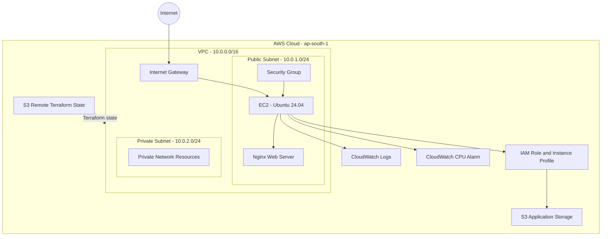

# AWS Infrastructure Automation with Terraform


## Project Overview

This project demonstrates Infrastructure as Code (IaC) by provisioning and managing AWS infrastructure using Terraform.

It deploys a secure, modular AWS environment hosting an Nginx-based resume website, with centralized logging, IAM-based access control, remote Terraform state management, and automated CI validation through GitHub Actions.

**Primary objectives:**
- Automate AWS infrastructure provisioning using Terraform.
- Implement reusable Terraform modules.
- Apply AWS networking and security best practices.
- Configure IAM roles and least-privilege access.
- Implement centralized monitoring and logging.
- Maintain infrastructure code using Git and GitHub Actions.

## Architecture

The infrastructure is deployed in the AWS Mumbai region (`ap-south-1`).

### Architecture Diagram



**Note:** The private subnet and route table are provisioned, but no NAT Gateway is deployed. The diagram represents the provisioned architecture, not an application traffic route through the private subnet.

## AWS Services Used

| Service | Purpose |
|---|---|
| Amazon VPC | Isolated virtual network |
| EC2 | Hosts the resume website |
| Internet Gateway | Public internet connectivity |
| Security Groups | Controls inbound and outbound traffic |
| S3 | Application storage and Terraform remote state |
| IAM | EC2 role and access permissions |
| CloudWatch Logs | Centralized instance log collection |
| CloudWatch Alarms | EC2 CPU utilization monitoring |
| EBS | Encrypted EC2 root storage |

## Terraform Module Structure

```text
terraform-aws-project/
│
├── .github/
│   └── workflows/
│       └── terraform-ci.yml
│
├── modules/
│   ├── networking/
│   │   ├── main.tf
│   │   └── outputs.tf
│   │
│   ├── security/
│   │   ├── main.tf
│   │   ├── variables.tf
│   │   └── outputs.tf
│   │
│   ├── storage/
│   │   ├── main.tf
│   │   └── outputs.tf
│   │
│   ├── compute/
│   │   ├── main.tf
│   │   ├── variables.tf
│   │   └── outputs.tf
│   │
│   └── iam/
│       ├── main.tf
│       ├── variables.tf
│       └── outputs.tf
│
├── main.tf
├── provider.tf
├── versions.tf
├── variables.tf
├── outputs.tf
├── terraform.tfvars
└── README.md
```

### Module Responsibilities

- **Networking:** VPC, public and private subnets, Internet Gateway, route tables and subnet associations.
- **Security:** EC2 security group and SSH key pair.
- **Storage:** S3 application bucket, versioning, encryption and public access protection.
- **Compute:** Ubuntu EC2 instance, Nginx deployment, CloudWatch log group and CPU alarm.
- **IAM:** EC2 IAM role, instance profile, S3 read-only policy and CloudWatch Agent permissions.

## Infrastructure Configuration

| Component | Configuration |
|---|---|
| AWS Region | ap-south-1 (Mumbai) |
| VPC CIDR | 10.0.0.0/16 |
| Public Subnet | 10.0.1.0/24 |
| Private Subnet | 10.0.2.0/24 |
| Availability Zones | ap-south-1a and ap-south-1b |
| EC2 Instance | t3.micro |
| Operating System | Ubuntu Server 24.04 LTS |
| Web Server | Nginx |
| Root Volume | 8 GB encrypted gp3 |
| Application Storage | Amazon S3 |
| Terraform State | S3 remote backend with native lockfile |

## Security Implementation

Security controls implemented in this project include:

- SSH access restricted to a specific public IPv4 CIDR.
- HTTP and HTTPS ingress rules configured in the EC2 security group.
- S3 Block Public Access enabled.
- S3 server-side encryption enabled using AES-256.
- S3 bucket versioning enabled.
- Encrypted EC2 root EBS volume.
- EC2 Instance Metadata Service Version 2 (IMDSv2) required.
- IAM instance profile used instead of storing long-lived AWS credentials on EC2.
- S3 read-only permissions scoped to the application bucket.
- CloudWatch Agent permissions assigned through an IAM role.

The SSH source CIDR should be updated when the administrator's public IP changes.

## Monitoring and Logging

Amazon CloudWatch is used for centralized monitoring and log collection.

### CloudWatch Logs

The CloudWatch Agent is installed and running on the EC2 instance.

The following logs are forwarded to:

`/terraform-aws-project/ec2`

| Log source | Purpose |
|---|---|
| Nginx access log | HTTP requests |
| Nginx error log | Web server errors |
| System log | Ubuntu system events |

Log retention is configured for seven days.

### CloudWatch CPU Alarm

Alarm name: `terraform-resume-high-cpu`

| Setting | Value |
|---|---|
| Metric | CPUUtilization |
| Namespace | AWS/EC2 |
| Statistic | Average |
| Threshold | 80% |
| Evaluation periods | 2 |
| Period | 300 seconds |

The alarm was verified in the `OK` state.

## Remote Terraform State

Terraform state is stored in a dedicated S3 backend bucket.

Implemented backend features:

- Remote state storage.
- S3 bucket versioning.
- Server-side encryption.
- Native S3 state locking using `use_lockfile = true`.

This avoids relying on a local Terraform state file and supports safer state management.

## GitHub Actions CI/CD

GitHub Actions automatically validates Terraform configuration when changes are pushed to the configured branches or pull requests are opened against `main`.

The workflow performs:

1. Repository checkout.
2. Terraform installation.
3. Terraform formatting verification.
4. Terraform initialization without a backend.
5. Terraform validation.

**CI status:** Successful workflow runs verified on the `feature/vpc-networking` branch.

The workflow performs validation only. It does not automatically deploy or destroy AWS infrastructure.

## Prerequisites

Install and configure:

- Terraform (1.17.1)
- AWS CLI
- Git
- An AWS account
- AWS IAM credentials with the required infrastructure permissions
- An SSH key pair

Configure AWS credentials:

```bash
aws configure
```

Verify the AWS identity:

```bash
aws sts get-caller-identity
```

## Deployment Instructions

Clone the repository:

```bash
git clone https://github.com/GOKULRAJGITHUB/terraform-aws-infrastructure.git

cd terraform-aws-infrastructure
```

Initialize Terraform:

```bash
terraform init
```

Format Terraform files:

```bash
terraform fmt -recursive
```

Validate configuration:

```bash
terraform validate
```

Review the execution plan:

```bash
terraform plan
```

Deploy infrastructure:

```bash
terraform apply
```

Review the Terraform outputs:

```bash
terraform output
```

Access the deployed website using the output `resume_website_url`.

## Verification Commands

Check Terraform infrastructure consistency:

```bash
terraform plan
```

Verify the EC2 instance:

```bash
aws ec2 describe-instances \
  --instance-ids i-087f0a1ab48550e99 \
  --region ap-south-1
```

Verify CloudWatch log streams:

```bash
aws logs describe-log-streams \
  --log-group-name /terraform-aws-project/ec2 \
  --region ap-south-1
```

Verify the CPU alarm:

```bash
aws cloudwatch describe-alarms \
  --alarm-names terraform-resume-high-cpu \
  --region ap-south-1
```

Verify website availability:

```bash
curl -I http://3.108.67.217
```

## Cleanup and Cost Management

AWS resources can incur charges while running.

Before destroying infrastructure:

1. Review the Terraform execution plan.
2. Identify resources that will be deleted.
3. Back up any required application data.
4. Confirm that the remote Terraform state is preserved or migrated appropriately.

Only then consider:

```bash
terraform plan -destroy
```

If the plan is correct:

```bash
terraform destroy
```

**Important:** The S3 bucket used for remote Terraform state is a separate backend resource. Do not delete it while Terraform still depends on it. Retire or migrate the backend deliberately after the infrastructure cleanup.

## Project Status

- [x] VPC and subnet provisioning
- [x] Internet Gateway and route tables
- [x] Security groups and SSH restrictions
- [x] S3 storage with encryption and versioning
- [x] EC2 instance and Nginx deployment
- [x] IAM role and instance profile
- [x] CloudWatch Agent installation
- [x] Centralized CloudWatch log collection
- [x] CloudWatch CPU alarm
- [x] S3 remote Terraform state and locking
- [x] GitHub Actions Terraform CI
- [x] Terraform formatting and validation
- [x] Infrastructure drift verification

## Author

**Gokul Raj**

GitHub: [GOKULRAJGITHUB](https://github.com/GOKULRAJGITHUB)

Repository: [terraform-aws-infrastructure](https://github.com/GOKULRAJGITHUB/terraform-aws-infrastructure)

---

*This project was developed as a hands-on demonstration of AWS infrastructure automation, Terraform modular design, cloud security, monitoring, and CI validation.*
